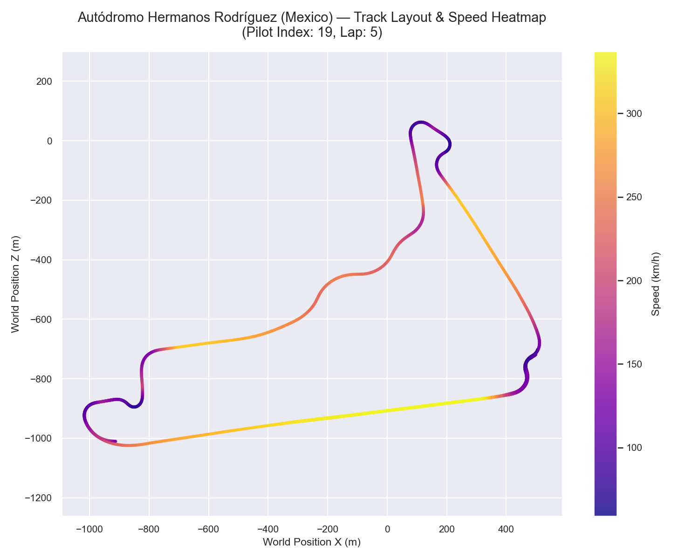
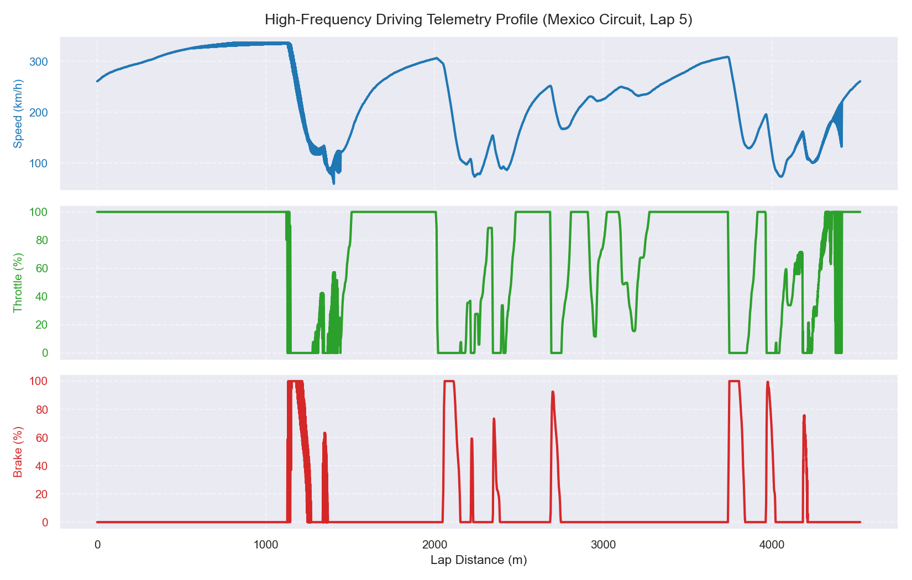
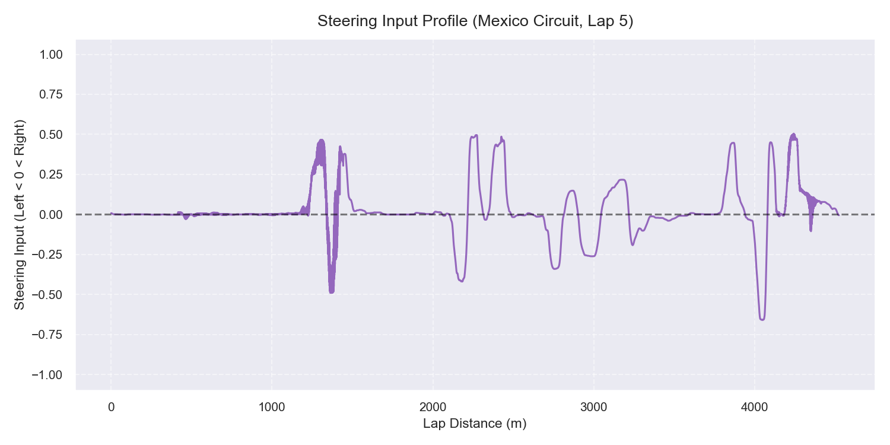
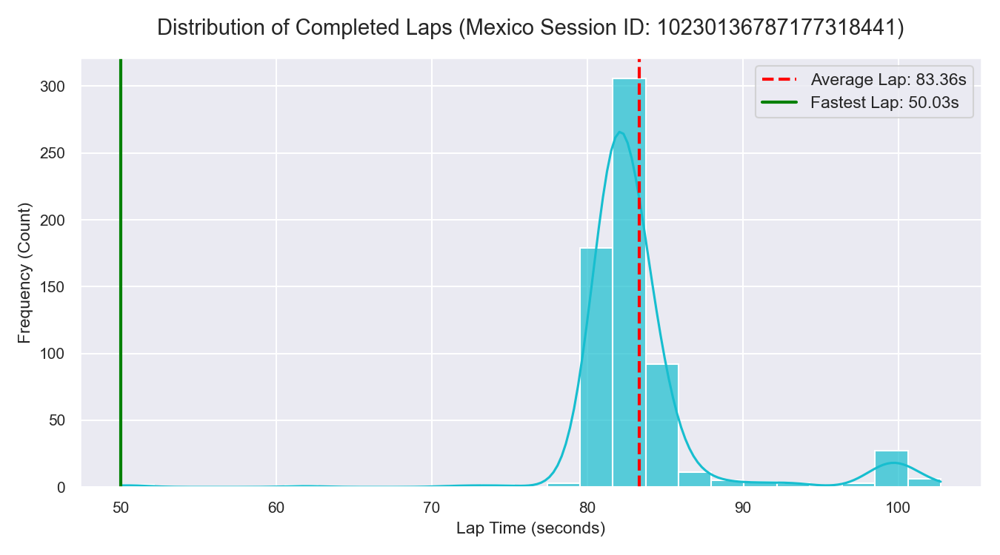

# Formula 1 Dataset Analysis

## 1. Dataset Overview
This report provides a comprehensive analysis and understanding of a **Formula 1 telemetry and race events dataset** located in the workspace root. 

The total dataset consists of **88 files** representing **22 separate race sessions** (one session for each of the 22 circuits planned for the 2020 Formula 1 calendar). The total dataset size is **11.47 GB** (12,318,185,323 bytes).

Each of the 22 sessions contains exactly 4 structured CSV files:
1. **`SessionData_<session_id>.csv`**: Session-level environmental and circuit metadata (weather, air/track temperatures, laps, track length).
2. **`ParticipantData_<session_id>.csv`**: Driver and constructor rosters for the session (driver names, constructor names, AI control status, engine RPM bounds).
3. **`RaceTimeData_<session_id>.csv`**: Lap-by-lap timing and sector breakdown for each driver (lap times, sector times in milliseconds, race positions).
4. **`TelemetryData_<session_id>.csv`**: High-frequency physics, controls, and vehicle systems telemetry (20 Hz sampling of speed, steering, throttle, brake, engine RPM, G-forces, tyre wear, temperatures, and ERS/hybrid state).

This dataset is generated from high-fidelity sim racing simulations (specifically, Codemasters F1 2020 game UDP telemetry captures) which map 1-to-1 with real-world F1 regulations, tracks, teams, and physics behaviors.

---

## 2. All 88 Files
Below is the complete list of all 88 files analyzed, including their size, row count, column count, category, and primary columns:

| File | Sheet | Rows | Columns | Category | Size (MB) | Important Columns |
| --- | --- | --- | --- | --- | --- | --- |
| ParticipantData_10230136787177318441.csv | Sheet1 | 20 | 6 | ParticipantData | 0.00 | pilot_index, driverId, teamId, aiControlled |
| ParticipantData_1087987310493855854.csv | Sheet1 | 20 | 6 | ParticipantData | 0.00 | pilot_index, driverId, teamId, aiControlled |
| ParticipantData_11752605864096667831.csv | Sheet1 | 20 | 6 | ParticipantData | 0.00 | pilot_index, driverId, teamId, aiControlled |
| ParticipantData_12837930614967511104.csv | Sheet1 | 20 | 6 | ParticipantData | 0.00 | pilot_index, driverId, teamId, aiControlled |
| ParticipantData_14577742557187250604.csv | Sheet1 | 20 | 6 | ParticipantData | 0.00 | pilot_index, driverId, teamId, aiControlled |
| ParticipantData_15052023430595064811.csv | Sheet1 | 20 | 6 | ParticipantData | 0.00 | pilot_index, driverId, teamId, aiControlled |
| ParticipantData_15313198597432510041.csv | Sheet1 | 20 | 6 | ParticipantData | 0.00 | pilot_index, driverId, teamId, aiControlled |
| ParticipantData_15525718781239906836.csv | Sheet1 | 20 | 6 | ParticipantData | 0.00 | pilot_index, driverId, teamId, aiControlled |
| ParticipantData_16345687902545417755.csv | Sheet1 | 20 | 6 | ParticipantData | 0.00 | pilot_index, driverId, teamId, aiControlled |
| ParticipantData_17192138584092610649.csv | Sheet1 | 20 | 6 | ParticipantData | 0.00 | pilot_index, driverId, teamId, aiControlled |
| ParticipantData_17729863945523124675.csv | Sheet1 | 20 | 6 | ParticipantData | 0.00 | pilot_index, driverId, teamId, aiControlled |
| ParticipantData_2048465535648368309.csv | Sheet1 | 20 | 6 | ParticipantData | 0.00 | pilot_index, driverId, teamId, aiControlled |
| ParticipantData_2909858075704986992.csv | Sheet1 | 20 | 6 | ParticipantData | 0.00 | pilot_index, driverId, teamId, aiControlled |
| ParticipantData_3335673977098133433.csv | Sheet1 | 20 | 6 | ParticipantData | 0.00 | pilot_index, driverId, teamId, aiControlled |
| ParticipantData_367597643936668713.csv | Sheet1 | 20 | 6 | ParticipantData | 0.00 | pilot_index, driverId, teamId, aiControlled |
| ParticipantData_4048657932346004126.csv | Sheet1 | 20 | 6 | ParticipantData | 0.00 | pilot_index, driverId, teamId, aiControlled |
| ParticipantData_4387289034743635457.csv | Sheet1 | 20 | 6 | ParticipantData | 0.00 | pilot_index, driverId, teamId, aiControlled |
| ParticipantData_470723873226893378.csv | Sheet1 | 20 | 6 | ParticipantData | 0.00 | pilot_index, driverId, teamId, aiControlled |
| ParticipantData_4873310982705891749.csv | Sheet1 | 20 | 6 | ParticipantData | 0.00 | pilot_index, driverId, teamId, aiControlled |
| ParticipantData_7308984749534057828.csv | Sheet1 | 20 | 6 | ParticipantData | 0.00 | pilot_index, driverId, teamId, aiControlled |
| ParticipantData_8377650301140219417.csv | Sheet1 | 20 | 6 | ParticipantData | 0.00 | pilot_index, driverId, teamId, aiControlled |
| ParticipantData_8690837730174169160.csv | Sheet1 | 20 | 6 | ParticipantData | 0.00 | pilot_index, driverId, teamId, aiControlled |
| RaceTimeData_10230136787177318441.csv | Sheet1 | 657 | 9 | RaceTimeData | 0.03 | pilot_index, LapTime, currentLapNum, sector1TimeInMS |
| RaceTimeData_1087987310493855854.csv | Sheet1 | 490 | 9 | RaceTimeData | 0.02 | pilot_index, LapTime, currentLapNum, sector1TimeInMS |
| RaceTimeData_11752605864096667831.csv | Sheet1 | 597 | 9 | RaceTimeData | 0.03 | pilot_index, LapTime, currentLapNum, sector1TimeInMS |
| RaceTimeData_12837930614967511104.csv | Sheet1 | 537 | 9 | RaceTimeData | 0.02 | pilot_index, LapTime, currentLapNum, sector1TimeInMS |
| RaceTimeData_14577742557187250604.csv | Sheet1 | 689 | 9 | RaceTimeData | 0.03 | pilot_index, LapTime, currentLapNum, sector1TimeInMS |
| RaceTimeData_15052023430595064811.csv | Sheet1 | 520 | 9 | RaceTimeData | 0.02 | pilot_index, LapTime, currentLapNum, sector1TimeInMS |
| RaceTimeData_15313198597432510041.csv | Sheet1 | 525 | 9 | RaceTimeData | 0.02 | pilot_index, LapTime, currentLapNum, sector1TimeInMS |
| RaceTimeData_15525718781239906836.csv | Sheet1 | 539 | 9 | RaceTimeData | 0.02 | pilot_index, LapTime, currentLapNum, sector1TimeInMS |
| RaceTimeData_16345687902545417755.csv | Sheet1 | 633 | 9 | RaceTimeData | 0.03 | pilot_index, LapTime, currentLapNum, sector1TimeInMS |
| RaceTimeData_17192138584092610649.csv | Sheet1 | 531 | 9 | RaceTimeData | 0.02 | pilot_index, LapTime, currentLapNum, sector1TimeInMS |
| RaceTimeData_17729863945523124675.csv | Sheet1 | 757 | 9 | RaceTimeData | 0.03 | pilot_index, LapTime, currentLapNum, sector1TimeInMS |
| RaceTimeData_2048465535648368309.csv | Sheet1 | 716 | 9 | RaceTimeData | 0.03 | pilot_index, LapTime, currentLapNum, sector1TimeInMS |
| RaceTimeData_2909858075704986992.csv | Sheet1 | 558 | 9 | RaceTimeData | 0.03 | pilot_index, LapTime, currentLapNum, sector1TimeInMS |
| RaceTimeData_3335673977098133433.csv | Sheet1 | 580 | 9 | RaceTimeData | 0.03 | pilot_index, LapTime, currentLapNum, sector1TimeInMS |
| RaceTimeData_367597643936668713.csv | Sheet1 | 561 | 9 | RaceTimeData | 0.03 | pilot_index, LapTime, currentLapNum, sector1TimeInMS |
| RaceTimeData_4048657932346004126.csv | Sheet1 | 421 | 9 | RaceTimeData | 0.02 | pilot_index, LapTime, currentLapNum, sector1TimeInMS |
| RaceTimeData_4387289034743635457.csv | Sheet1 | 524 | 9 | RaceTimeData | 0.02 | pilot_index, LapTime, currentLapNum, sector1TimeInMS |
| RaceTimeData_470723873226893378.csv | Sheet1 | 701 | 9 | RaceTimeData | 0.03 | pilot_index, LapTime, currentLapNum, sector1TimeInMS |
| RaceTimeData_4873310982705891749.csv | Sheet1 | 510 | 9 | RaceTimeData | 0.02 | pilot_index, LapTime, currentLapNum, sector1TimeInMS |
| RaceTimeData_7308984749534057828.csv | Sheet1 | 631 | 9 | RaceTimeData | 0.03 | pilot_index, LapTime, currentLapNum, sector1TimeInMS |
| RaceTimeData_8377650301140219417.csv | Sheet1 | 687 | 9 | RaceTimeData | 0.03 | pilot_index, LapTime, currentLapNum, sector1TimeInMS |
| RaceTimeData_8690837730174169160.csv | Sheet1 | 545 | 9 | RaceTimeData | 0.02 | pilot_index, LapTime, currentLapNum, sector1TimeInMS |
| SessionData_10230136787177318441.csv | Sheet1 | 1 | 6 | SessionData | 0.00 | trackId, trackLength, weather, airTemperature |
| SessionData_1087987310493855854.csv | Sheet1 | 1 | 6 | SessionData | 0.00 | trackId, trackLength, weather, airTemperature |
| SessionData_11752605864096667831.csv | Sheet1 | 1 | 6 | SessionData | 0.00 | trackId, trackLength, weather, airTemperature |
| SessionData_12837930614967511104.csv | Sheet1 | 1 | 6 | SessionData | 0.00 | trackId, trackLength, weather, airTemperature |
| SessionData_14577742557187250604.csv | Sheet1 | 1 | 6 | SessionData | 0.00 | trackId, trackLength, weather, airTemperature |
| SessionData_15052023430595064811.csv | Sheet1 | 1 | 6 | SessionData | 0.00 | trackId, trackLength, weather, airTemperature |
| SessionData_15313198597432510041.csv | Sheet1 | 1 | 6 | SessionData | 0.00 | trackId, trackLength, weather, airTemperature |
| SessionData_15525718781239906836.csv | Sheet1 | 1 | 6 | SessionData | 0.00 | trackId, trackLength, weather, airTemperature |
| SessionData_16345687902545417755.csv | Sheet1 | 1 | 6 | SessionData | 0.00 | trackId, trackLength, weather, airTemperature |
| SessionData_17192138584092610649.csv | Sheet1 | 1 | 6 | SessionData | 0.00 | trackId, trackLength, weather, airTemperature |
| SessionData_17729863945523124675.csv | Sheet1 | 1 | 6 | SessionData | 0.00 | trackId, trackLength, weather, airTemperature |
| SessionData_2048465535648368309.csv | Sheet1 | 1 | 6 | SessionData | 0.00 | trackId, trackLength, weather, airTemperature |
| SessionData_2909858075704986992.csv | Sheet1 | 1 | 6 | SessionData | 0.00 | trackId, trackLength, weather, airTemperature |
| SessionData_3335673977098133433.csv | Sheet1 | 1 | 6 | SessionData | 0.00 | trackId, trackLength, weather, airTemperature |
| SessionData_367597643936668713.csv | Sheet1 | 1 | 6 | SessionData | 0.00 | trackId, trackLength, weather, airTemperature |
| SessionData_4048657932346004126.csv | Sheet1 | 1 | 6 | SessionData | 0.00 | trackId, trackLength, weather, airTemperature |
| SessionData_4387289034743635457.csv | Sheet1 | 1 | 6 | SessionData | 0.00 | trackId, trackLength, weather, airTemperature |
| SessionData_470723873226893378.csv | Sheet1 | 1 | 6 | SessionData | 0.00 | trackId, trackLength, weather, airTemperature |
| SessionData_4873310982705891749.csv | Sheet1 | 1 | 6 | SessionData | 0.00 | trackId, trackLength, weather, airTemperature |
| SessionData_7308984749534057828.csv | Sheet1 | 1 | 6 | SessionData | 0.00 | trackId, trackLength, weather, airTemperature |
| SessionData_8377650301140219417.csv | Sheet1 | 1 | 6 | SessionData | 0.00 | trackId, trackLength, weather, airTemperature |
| SessionData_8690837730174169160.csv | Sheet1 | 1 | 6 | SessionData | 0.00 | trackId, trackLength, weather, airTemperature |
| TelemetryData_10230136787177318441.csv | Sheet1 | 1,180,640 | 56 | TelemetryData | 547.91 | sessionTime, speed, throttle, brake, steer, gear, actualTyreCompound, tyresWear |
| TelemetryData_1087987310493855854.csv | Sheet1 | 930,040 | 56 | TelemetryData | 465.05 | sessionTime, speed, throttle, brake, steer, gear, actualTyreCompound, tyresWear |
| TelemetryData_11752605864096667831.csv | Sheet1 | 1,290,560 | 56 | TelemetryData | 647.89 | sessionTime, speed, throttle, brake, steer, gear, actualTyreCompound, tyresWear |
| TelemetryData_12837930614967511104.csv | Sheet1 | 1,024,880 | 56 | TelemetryData | 514.07 | sessionTime, speed, throttle, brake, steer, gear, actualTyreCompound, tyresWear |
| TelemetryData_14577742557187250604.csv | Sheet1 | 1,046,820 | 56 | TelemetryData | 524.28 | sessionTime, speed, throttle, brake, steer, gear, actualTyreCompound, tyresWear |
| TelemetryData_15052023430595064811.csv | Sheet1 | 1,104,840 | 56 | TelemetryData | 554.09 | sessionTime, speed, throttle, brake, steer, gear, actualTyreCompound, tyresWear |
| TelemetryData_15313198597432510041.csv | Sheet1 | 987,220 | 56 | TelemetryData | 496.48 | sessionTime, speed, throttle, brake, steer, gear, actualTyreCompound, tyresWear |
| TelemetryData_15525718781239906836.csv | Sheet1 | 1,184,380 | 56 | TelemetryData | 550.48 | sessionTime, speed, throttle, brake, steer, gear, actualTyreCompound, tyresWear |
| TelemetryData_16345687902545417755.csv | Sheet1 | 1,130,040 | 56 | TelemetryData | 565.90 | sessionTime, speed, throttle, brake, steer, gear, actualTyreCompound, tyresWear |
| TelemetryData_17192138584092610649.csv | Sheet1 | 1,088,540 | 56 | TelemetryData | 508.25 | sessionTime, speed, throttle, brake, steer, gear, actualTyreCompound, tyresWear |
| TelemetryData_17729863945523124675.csv | Sheet1 | 1,250,040 | 56 | TelemetryData | 628.06 | sessionTime, speed, throttle, brake, steer, gear, actualTyreCompound, tyresWear |
| TelemetryData_2048465535648368309.csv | Sheet1 | 1,004,460 | 56 | TelemetryData | 505.28 | sessionTime, speed, throttle, brake, steer, gear, actualTyreCompound, tyresWear |
| TelemetryData_2909858075704986992.csv | Sheet1 | 1,040,000 | 56 | TelemetryData | 520.64 | sessionTime, speed, throttle, brake, steer, gear, actualTyreCompound, tyresWear |
| TelemetryData_3335673977098133433.csv | Sheet1 | 1,095,100 | 56 | TelemetryData | 551.21 | sessionTime, speed, throttle, brake, steer, gear, actualTyreCompound, tyresWear |
| TelemetryData_367597643936668713.csv | Sheet1 | 1,113,180 | 56 | TelemetryData | 557.81 | sessionTime, speed, throttle, brake, steer, gear, actualTyreCompound, tyresWear |
| TelemetryData_4048657932346004126.csv | Sheet1 | 972,420 | 56 | TelemetryData | 490.55 | sessionTime, speed, throttle, brake, steer, gear, actualTyreCompound, tyresWear |
| TelemetryData_4387289034743635457.csv | Sheet1 | 1,022,920 | 56 | TelemetryData | 514.97 | sessionTime, speed, throttle, brake, steer, gear, actualTyreCompound, tyresWear |
| TelemetryData_470723873226893378.csv | Sheet1 | 1,071,280 | 56 | TelemetryData | 537.02 | sessionTime, speed, throttle, brake, steer, gear, actualTyreCompound, tyresWear |
| TelemetryData_4873310982705891749.csv | Sheet1 | 940,780 | 56 | TelemetryData | 472.21 | sessionTime, speed, throttle, brake, steer, gear, actualTyreCompound, tyresWear |
| TelemetryData_7308984749534057828.csv | Sheet1 | 1,070,980 | 56 | TelemetryData | 539.66 | sessionTime, speed, throttle, brake, steer, gear, actualTyreCompound, tyresWear |
| TelemetryData_8377650301140219417.csv | Sheet1 | 995,580 | 56 | TelemetryData | 501.13 | sessionTime, speed, throttle, brake, steer, gear, actualTyreCompound, tyresWear |
| TelemetryData_8690837730174169160.csv | Sheet1 | 1,097,960 | 56 | TelemetryData | 553.98 | sessionTime, speed, throttle, brake, steer, gear, actualTyreCompound, tyresWear |

---

## 3. Sheet Information
Since the source files are in **CSV (Comma-Separated Values)** format, they are single-table flat files rather than multi-sheet workbooks.
* **Number of sheets per file**: 1
* **Default sheet name**: `Sheet1` (when opened in spreadsheet software like Excel)
* **Data structure**: Row-column tabular format with a single header row on line 1.

---

## 4. Row and Column Counts
The row and column counts vary significantly by category, reflecting different aggregation levels:
* **SessionData** (22 files): Exactly **1 row** and **6 columns** per file. (Total rows: 22)
* **ParticipantData** (22 files): Exactly **20 rows** (representing the 20 drivers on the F1 grid) and **6 columns** per file. (Total rows: 440)
* **RaceTimeData** (22 files): Between **420 and 757 rows** per file (representing all laps completed by all 20 drivers in that race) and **9 columns**. (Total rows: 12,852)
* **TelemetryData** (22 files): Large files containing between **930,040 and 1,290,560 rows** per file and **56 columns**. (Total rows: 23,642,660)

* **Grand Total Rows**: **23,655,974 rows** of data.
* **Grand Total Size**: **11.47 GB** on disk.

---

## 5. Column Information
The columns and their data types for each of the four categories are as follows:

### A. SessionData
* **weather** (`int64`): Weather state (0 = Clear/Dry).
* **trackTemperature** (`int64`): Track surface temperature in Celsius (typically 30-35°C).
* **airTemperature** (`int64`): Ambient air temperature in Celsius (typically 20-25°C).
* **totalLaps** (`int64`): Total scheduled laps for the race.
* **trackLength** (`int64`): Total circuit length in meters.
* **trackId** (`object` / `string`): Name of the circuit (e.g., 'Mexico', 'Monza', 'Monaco').

### B. ParticipantData
* **pilot_index** (`int64`): Identifier index for the driver within the session (0 to 19).
* **aiControlled** (`int64`): Binary flag indicating if the driver is AI-controlled (1 = AI, 0 = Human Player).
* **driverId** (`object` / `string`): Driver name (e.g., 'Lewis Hamilton', 'Max Verstappen').
* **teamId** (`object` / `string`): Constructor team name (e.g., 'Mercedes', 'Red Bull Racing').
* **maxRPM** (`int64`): Maximum engine RPM (typically 13,000).
* **idleRPM** (`int64`): Idle engine RPM (typically 3,500 - 4,300).

### C. RaceTimeData
* **frameIdentifierStart** (`int64`): Start frame index of the lap.
* **frameIdentifierStop** (`int64`): End frame index of the lap.
* **pilot_index** (`int64`): Driver index (0-19).
* **LapTime** (`float64`): Completed lap time in seconds.
* **sector1TimeInMS** (`int64`): Sector 1 duration in milliseconds.
* **sector2TimeInMS** (`int64`): Sector 2 duration in milliseconds.
* **sector3TimeInMS** (`int64`): Sector 3 duration in milliseconds.
* **carPosition** (`int64`): Race position of the car at the end of the lap.
* **currentLapNum** (`int64`): Lap number.

### D. TelemetryData
* **Vehicle Control Inputs (6)**: `throttle` (`float64`, 0.0-1.0), `brake` (`float64`, 0.0-1.0), `steer` (`float64`, -1.0 to 1.0), `clutch` (`int64`), `gear` (`int64`, 0-8), `drs` (`int64`, 0/1).
* **Vehicle Status & Kinematics (11)**: `speed` (`int64` in km/h), `engineRPM` (`int64`), `engineTemperature` (`int64`), `yaw`, `pitch`, `roll` (`float64` orientations), `worldPositionX`, `worldPositionY`, `worldPositionZ` (`float64` coords), `worldVelocityX`, `worldVelocityY`, `worldVelocityZ` (`float64` velocities).
* **Forces (6)**: `worldForwardDirX/Y/Z`, `worldRightDirX/Y/Z` (`int64`), `gForceLateral`, `gForceLongitudinal`, `gForceVertical` (`float64`).
* **Multi-Wheel Array Strings (7)**: (Format: RearLeft/RearRight/FrontLeft/FrontRight)
  * `brakesTemperature` (`object`): brake disc temps in °C.
  * `tyresSurfaceTemperature` (`object`): tyre carcass outer temps in °C.
  * `tyresInnerTemperature` (`object`): tyre carcass inner temps in °C.
  * `tyresPressure` (`object`): tyre pressures in PSI.
  * `tyresWear` (`object`): tyre wear percentage (0.0 to 100.0).
  * `tyresDamage` (`object`): tyre damage percentage.
  * `surfaceType` (`object`): track surface type (0 = track, 1 = rumble kerb, 7 = off-track/grass/gravel).
* **Fuel & Strategy (4)**: `fuelMix` (`float64`), `pitLimiterStatus` (`float64`), `fuelInTank` (`float64` in kg), `fuelRemainingLaps` (`float64`).
* **ERS Hybrid System (6)**: `ersStoreEnergy` (`float64` in Joules, 0 - 4MJ), `ersDeployMode` (`float64`), `ersHarvestedThisLapMGUK`, `ersHarvestedThisLapMGUH`, `ersDeployedThisLap` (`float64`).
* **Race Progress & Identification (10)**: `sessionTime` (`float64`), `frameIdentifier` (`int64`), `pilot_index` (`int64`), `carPosition` (`int64`), `currentLapTime` (`float64`), `currentLapNum` (`int64`), `lapDistance` (`float64`), `totalDistance` (`float64`), `pitStatus` (`object`: 'pitting', 'in pit area', or Null), `sector` (`int64`), `driverStatus` (`object`: 'on track'), `resultStatus` (`object`: 'active').
## 6. Missing Values
The data quality is exceptionally high, with missing values (nulls) restricted to very specific columns and scenarios:

1. **SessionData, ParticipantData, RaceTimeData**: **0 null values** across all files and columns.
2. **TelemetryData**:
   * **`pitStatus` (96.08% nulls / 22,715,605 missing)**: This is **expected and clean**. The column is null when the driver is on-track and contains strings ('pitting', 'in pit area') only during pit lane events.
   * **`resultStatus` (3.0% nulls / 706,848 missing)**: Missing on certain session boundaries or retired cars.
   * **Fuel & ERS Systems (4,280 nulls)**: A minute amount of missing values occurring at the start or termination of logging.
   * **Controls & Speeds (1,920 nulls)**: Tiny dropouts at the frame level, easily filled using forward-fill (FFill).

---

## 7. Duplicate Records
Duplicate analysis was executed using an optimized identifier-based logic.
* **Full-Row duplicates (SessionData, ParticipantData, RaceTimeData)**: **0 duplicates** found.
* **Telemetry Identifier duplicates `(session_id, pilot_index, frameIdentifier)`**: **0 duplicates** found. 
Each telemetry file represents a unique session, and within each session, each driver (`pilot_index`) has exactly one telemetry record per physics frame (`frameIdentifier`).

---

## 8. Dataset Relationships
The dataset is structured as a relational database. The relationships are illustrated in the text diagram below:

```text
SessionData
   │
   └── session_id (implicit via filename suffix)
          │
          ├── [1-to-Many] ── ParticipantData ( Roster: pilot_index ──> driverId, teamId )
          │
          ├── [1-to-Many] ── RaceTimeData ( Laps: pilot_index, currentLapNum, frame boundaries )
          │
          └── [1-to-Many] ── TelemetryData ( High-freq: pilot_index, frameIdentifier, currentLapNum )
```

### Key Join Mechanisms:
* **Session Mapping**: Map any category file to its session metadata (track length, track ID, weather) by joining on the **`session_id`** suffix in the filename.
* **Driver Mapping**: Resolve the driver identity in `RaceTimeData` and `TelemetryData` by joining on **`pilot_index`** with `ParticipantData` from the same session.
* **Lap-to-Telemetry Mapping**:
  * **Direct Join**: Match `TelemetryData` rows to `RaceTimeData` lap rows using `(session_id, pilot_index, currentLapNum)`.
  * **Temporal Join**: A telemetry record belongs to a specific lap if its `frameIdentifier` falls within:
    `frameIdentifierStart <= TelemetryData.frameIdentifier <= frameIdentifierStop` for the same `pilot_index`.

---

## 9. Data Quality
The data is highly clean, consistent, and structured, but several domain-specific quality aspects and outliers must be managed:

### A. Lap Time Outliers (RaceTimeData)
* **Short Laps (Fastest Lap = 11.061s)**: There are **163 laps** across the dataset with duration **< 40 seconds**. These are anomalies caused by track-limit cuts, simulation resets, or mid-session joins.
* **Slow Laps (Slowest Lap = 2281.338s / 38 mins)**: These are out-laps, in-laps, or sessions where a driver stood idle in the pits.
* **Solution**: Clean the lap data by filtering `45.0 <= LapTime <= 150.0` seconds to obtain realistic racing laps.

### B. Spatially Encoded Wheel Data
Columns like `tyresWear` ("0.0/0.0/0.0/0.0") are strings. In preprocessing, these must be split by `/` and converted to float values representing Rear-Left, Rear-Right, Front-Left, and Front-Right tyres.

### C. Off-Track Flags via `surfaceType`
The `surfaceType` column encodes off-track status (e.g. `7` represents grass/gravel). Strings containing `7` (e.g., `"7/7/0/0"`) denote that one or more wheels have left the track limits, which provides a direct ground truth for **track limit violations**.

### D. Telemetry Frequency and Jitter
* **Telemetry Sampling Rate**: **19.08 Hz** (Mean interval: ~0.052 seconds / 52 ms).
* **Jitter**: Standard deviation of interval is **5.6 ms**. This indicates a highly stable and constant sampling frequency, suitable for time-series forecasting.

---

## 10. Available F1 Data
The dataset contains a rich set of channels mirroring real-world telemetry systems:
* **Driver Control Inputs**: High-frequency recording of Throttle, Brake, Steering, Gear, DRS, Clutch.
* **Kinematics & Dynamics**: 3D Coordinates (X, Y, Z), 3D Velocity vectors, G-forces (lateral, longitudinal, vertical), Yaw, Pitch, Roll.
* **Car Status**: Engine RPM, Speed, Engine Temperature, Brake Temperatures, Tyre Pressures, Tyre Outer/Inner Temperatures.
* **Hybrid Systems**: Energy stored in ERS battery (Joules), MGU-K energy harvested, MGU-H energy harvested, ERS deployment mode.
* **State Flags**: Pit status ('pitting', 'in pit area', or null), Surface type under each wheel, Fuel load.

---

## 11. Dataset Statistics
* **Number of seasons**: 1 (the 2020 F1 season grid).
* **Number of sessions/races**: 22 sessions.
* **Number of drivers**: 20 drivers.
* **Number of constructors/teams**: 10 teams.
* **Number of unique circuits/tracks**: 22 circuits.
* **Number of race results (completed laps)**: 12,852 laps.
* **Number of telemetry records**: 23,642,660 rows.
* **Average clean lap time**: 91.98 seconds.
* **Total telemetry data size**: 12.3 GB.

### Track Breakdown:
| Track | Total Laps | Fastest Lap | Average Clean Lap | Telemetry Rows | Track Length (m) |
| --- | --- | --- | --- | --- | --- |
| Austin | 541 | 16.410s | 100.411s | 1,097,960 | 5,514m |
| Baku | 519 | 20.580s | 108.068s | 1,104,840 | 5,994m |
| Brazil | 710 | 12.958s | 74.403s | 1,004,460 | 4,294m |
| Catalunya | 629 | 11.061s | 83.302s | 1,070,980 | 4,650m |
| Hanoi | 537 | 12.203s | 103.949s | 1,184,380 | 5,606m |
| Hungaroring | 632 | 20.553s | 83.402s | 1,130,040 | 4,378m |
| Marina Bay | 593 | 20.776s | 107.577s | 1,290,560 | 5,063m |
| Melbourne | 554 | 19.266s | 89.899s | 1,040,000 | 5,301m |
| Mexico | 657 | 11.240s | 83.363s | 1,180,640 | 4,525m |
| Monaco | 753 | 21.845s | 78.068s | 1,250,040 | 3,323m |
| Montreal | 685 | 23.061s | 76.671s | 1,046,820 | 4,371m |
| Monza | 488 | 20.508s | 87.616s | 930,040 | 5,798m |
| Paul Ricard | 524 | 17.334s | 98.013s | 1,022,920 | 5,815m |
| RedBull Ring | 684 | 16.463s | 70.874s | 995,580 | 4,323m |
| Sakhir | 577 | 12.440s | 95.066s | 1,095,100 | 5,408m |
| Shanghai | 531 | 12.439s | 99.991s | 1,088,540 | 5,441m |
| Silverstone | 509 | 21.629s | 93.145s | 940,780 | 5,896m |
| Sochi | 532 | 30.427s | 100.758s | 1,024,880 | 5,824m |
| Spa | 420 | 16.402s | 111.140s | 972,420 | 7,003m |
| Suzuka | 521 | 20.800s | 95.280s | 987,220 | 5,817m |
| Yas Marina | 559 | 28.434s | 103.807s | 1,113,180 | 5,547m |
| Zandvoort | 697 | 12.859s | 77.072s | 1,071,280 | 4,257m |

---

## 12. Machine Learning Possibilities
This dataset can support several sophisticated machine learning tasks:

### A. Lap-Time Prediction (Pre-Race & Live)
* **Target**: `LapTime` (float, in seconds).
* **Features**: Track length, track ID, ambient temp, driver, team, tyre compound, ERS deploy mode. Live prediction adds sector times (`sector1TimeInMS`, `sector2TimeInMS`) and fuel load.
* **Usable Records**: 12,689 clean laps (filtered for outliers).
* **Algorithms**: LightGBM, XGBoost, Random Forest.
* **Evaluation Metrics**: MAE (seconds), RMSE, R².
* **Data Leakage Risks**: Using `sector3TimeInMS` or any post-lap telemetry to predict lap time.
* **Feasibility**: High (extremely strong regression baseline).
* **Additional Data Required**: None.

### B. Driver Classification (Identity Profiling)
* **Target**: `pilot_index` (classification, 20 classes).
* **Features**: Steering angle variance, throttle release rate, braking pressure curves, gear shifting RPM points, apex speed profile.
* **Usable Records**: 12,689 laps (each lap treated as a time-series matrix of shape `[Length, 6 Inputs]`).
* **Algorithms**: 1D-CNN, LSTM, or Random Forest on statistical aggregates (mean, std, max, entropy of inputs).
* **Evaluation Metrics**: Accuracy, F1-Score (Macro), Confusion Matrix.
* **Data Leakage Risks**: Including track coordinates `(worldPositionX, worldPositionZ)` or `trackId`. If included, the model will classify based on track-specific mappings rather than driving signatures.
* **Feasibility**: High (drivers have distinct telemetry fingerprints).
* **Additional Data Required**: None.

### C. Driving-Style Classification
* **Target**: Driving style class (e.g. Smooth, Aggressive, Hesitant, Late Braker).
* **Features**: Throttle rate of change, steering entropy, maximum G-forces, braking deceleration rate.
* **Usable Records**: 12,689 laps.
* **Algorithms**: K-Means clustering (unsupervised profiling) followed by Random Forest classifier.
* **Evaluation Metrics**: Silhouette Score (clustering), Accuracy (classification).
* **Data Leakage Risks**: High speed on straights should not bias style. Inputs must be normalized.
* **Feasibility**: Medium (requires unsupervised labeling).
* **Additional Data Required**: Domain-expert threshold rules for labeling.

### D. Telemetry Anomaly Detection
* **Target**: Binary anomaly flag (Mistake / Normal).
* **Features**: G-forces, speed, steering angle, throttle, brake, engine RPM, wheelspin flags.
* **Usable Records**: 23,642,660 telemetry frames.
* **Algorithms**: Isolation Forest, Autoencoders (reconstruction error), One-Class SVM.
* **Evaluation Metrics**: Precision, Recall, F1-Score (evaluated against manual mistake labels, e.g., off-track via `surfaceType` containing `7`).
* **Data Leakage Risks**: Using post-accident resultStatus or pitStatus.
* **Feasibility**: High (off-track excursions are labeled via `surfaceType`).
* **Additional Data Required**: None (labels exist inside `surfaceType`).

### E. Driver Telemetry Comparison & Lap Optimization
* **Target**: Time Delta (dt) at any point along the track.
* **Features**: Telemetry differences (speed diff, throttle diff, braking distance diff) aligned by `lapDistance`.
* **Usable Records**: 23.6M telemetry frames.
* **Algorithms**: Dynamic Time Warping (DTW) for spatial alignment, followed by rule-based heuristic comparisons.
* **Evaluation Metrics**: Sub-second alignment accuracy.
* **Data Leakage Risks**: None.
* **Feasibility**: Extremely High (highly valuable for driver coaching).
* **Additional Data Required**: None.

---

## 13. Data Leakage Risks
Data leakage is a severe risk in telemetry ML. To build a valid predictive model, we must strictly separate pre-event features from post-event features.

| Task | Prediction Event | Safe Features (Available BEFORE Event) | Leaked Features (Only Available AFTER Event) |
| --- | --- | --- | --- |
| **Lap-Time Prediction** | Start of Lap | trackId, airTemperature, trackTemperature, tyreCompound, fuelInTank, historical driver pace | lapTime, sector times, tyreWear at lap end, DRS zones used, fuel consumed, speed telemetry during the lap |
| **Live Lap-Time Prediction** | Sector 2 Exit | trackId, sector1TimeInMS, sector2TimeInMS, initial fuel, driverId | sector3TimeInMS, speed in sector 3, final position, finishing status |
| **Driver Classification** | Post-Session | Telemetry inputs normalized by speed (throttle, brake, steer, gear, RPM) | trackId, session_id, spatial coordinates `(X, Y, Z)` (locks model to specific track/session) |
| **Race Strategy / Pit Prediction** | Current Lap | Current tyreWear, lap number, trackLength, tyre compound, distance to leader, gaps | Next tyre compound, final pit stop count, final finishing position, fuel mix used later |

---

## 14. Recommended FYP Ideas
Based on the F1 telemetry dataset, here are the three strongest, technically feasible, and academically valuable Final Year Project (FYP) recommendations:

### 🥇 Best (First): F1 Driver "Digital Twin" & Telemetry Coaching System
An AI-driven telemetry analytics platform that compares a driver's lap against a "gold standard" (the fastest lap on the track), automatically identifies where and why they lose time, segments the track into corners, classifies driving errors (e.g. early braking, throttle hesitation), and provides interactive 3D visualizations.

### 🥈 Second: Live F1 Sector & Lap-Time Predictor
A real-time strategy forecasting model that uses live telemetry and sector-by-sector driver metrics during a race lap to predict final lap times, pacing deltas, and potential strategy windows (undercuts/overcuts) for race engineers.

### 🥉 Third: Unsupervised Driver Anomaly & Track Limits Detection System
An automated telemetry review system for race stewards that monitors UDP packet streams, detects driving anomalies (brake lockups, spins, collisions), identifies track limit violations using wheel surface telemetry, and highlights driving errors.

---

## 15. Best FYP Recommendation
* **Project Title**: **F1 Driver "Digital Twin" & Telemetry Coaching System**
* **Problem Statement**: In motorsport and sim racing, drivers spend hours analyzing telemetry overlay charts to find where they are losing time compared to their teammates. However, understanding raw telemetry squiggles is difficult for amateur and intermediate drivers, and they lack personalized, actionable feedback.
* **Objective**: Build an AI-driven F1 Telemetry Coaching System that compares a driver's telemetry against a reference lap, detects exactly which corners they are losing time in, classifies their cornering errors (e.g., early braking, poor throttle application, slow apex speed), and provides natural language coaching feedback alongside interactive 3D visualizations of the track and inputs.
* **Dataset Used**: `TelemetryData` and `RaceTimeData` across 22 tracks, focusing on comparing human player laps (`aiControlled = 0`) with the fastest AI driver laps (`aiControlled = 1`).
* **Features**: `speed`, `throttle`, `brake`, `steer`, `gear`, `engineRPM`, `lapDistance`, `worldPositionX`, `worldPositionZ`, `tyresWear`, `tyresPressure`.
* **ML Approach**:
  1. **Dynamic Time Warping (DTW)** or **Spatial Interpolation**: Align telemetry series of unequal lengths by projecting them onto a uniform `lapDistance` axis.
  2. **Track Segmentation**: Identify corners by computing curvature along the track coordinates and grouping low-speed segments.
  3. **Classification Model**: Train a Random Forest or Gradient Boosting model on corner-level features (e.g., peak braking pressure, braking distance to apex, throttle-on distance from apex) to classify cornering errors.
* **Target**: Corner-level error class (e.g., "Early Braking", "Slow Apex Speed", "Oversteering", "Throttle Hesitation", "Perfect Corner").
* **Evaluation Metrics**: F1-Score (macro) for error classification, Mean Absolute Error (MAE) for predicted time loss per corner.
* **Difficulty**: **Medium-High**. Requires solid understanding of signal processing, coordinate systems, and classification models, but utilizes highly structured data.
* **Academic Value**: Strong application of spatial-temporal alignment, signal processing, time-series segmentation, and multiclass classification.
* **Portfolio Value**: Excellent. Renders interactive 3D track reconstructions and overlay charts, making it a highly visual, state-of-the-art web application.
* **Limitations**: Telemetry files are large and require preprocessing pipelines. The system is restricted to dry track conditions due to the lack of wet sessions in this specific raw dataset.
* **Additional Data Required**: Real-world track corner names/numbering to display friendly corner names (e.g. "Turn 4 - Monza") in the UI.

---

## 16. Recommended Architecture
A complete system architecture for the F1 Telemetry Coaching System is detailed below:

```text
       ┌─────────────────────────────────────────────────────────┐
       │                 REACT / NEXT.JS FRONTEND                │
       │  (Three.js 3D Track Layout, Recharts Overlay Graphs)    │
       └────────────────────────────┬────────────────────────────┘
                                    │ (JSON / HTTPS)
                                    ▼
       ┌─────────────────────────────────────────────────────────┐
       │                   FASTAPI BACKEND API                   │
       │      (Endpoints: /tracks, /sessions, /coaching)         │
       └────────────────────────────┬────────────────────────────┘
                                    │
                                    ▼
       ┌─────────────────────────────────────────────────────────┐
       │            ANALYTICS & MACHINE LEARNING LAYER           │
       │                                                         │
       │   ┌────────────────────┐      ┌────────────────────┐    │
       │   │ Spatial Alignment  │      │ Track Segmentation │    │
       │   │   (DTW / SciPy)    │      │  (Curvature Calc)  │    │
       │   └─────────┬──────────┘      └─────────┬──────────┘    │
       │             │                           │               │
       │             └─────────────┬─────────────┘               │
       │                           ▼                             │
       │             ┌──────────────────────────┐                │
       │             │   Classifier Model       │                │
       │             │ (XGBoost Corner Profiler)│                │
       │             └──────────────────────────┘                │
       └────────────────────────────┬────────────────────────────┘
                                    │ (Optimized Reads)
                                    ▼
       ┌─────────────────────────────────────────────────────────┐
       │                   DATA STORAGE LAYER                    │
       │        (DuckDB / Parquet for Fast Telemetry Queries)    │
       └─────────────────────────────────────────────────────────┘
```

### Component Details:
1. **Frontend (Dashboard)**:
   * **Three.js / React Three Fiber**: Renders the 3D track model from spatial coordinates `(X, Y, Z)`. Colors the track path (Speed Heatmap) to show braking zones.
   * **Telemetry Graph Panel**: Overlays speed, throttle, and brake curves of the player and reference laps.
   * **AI Coach Panel**: Displays structured coaching text and corner-by-corner performance grades.
2. **Backend API (FastAPI)**:
   * Serves metadata of tracks and sessions.
   * Runs the processing pipeline when a user selects a lap to compare.
3. **Analytics & ML Engine**:
   * **SciPy Signal**: Filters high-frequency noise and performs 1D linear interpolation to align telemetry values onto a standard 1-meter distance grid.
   * **Curvature Calculator**: Identifies corners.
   * **Corner Profiler (XGBoost)**: Predicts the driving error.
4. **Data Storage**:
   * **DuckDB**: Essential for querying 23.6 million rows of telemetry. Converts the raw CSV files into an indexed DuckDB database file. This allows querying a single lap in **< 10ms**, bypassing the slow Pandas CSV read bottleneck.

---

## 17. Additional Data Required
To build a fully comprehensive application, the following external data points should be integrated:
1. **Real F1 Track Maps & Turn Lists**: Official corner names and numbers to map the raw spatial coordinates to recognizable track names (e.g. "Monza Turn 1: Variante del Rettifilo").
2. **Real F1 Driver & Team Profiles**: High-resolution driver photos and team logo assets for UI components.
3. **Track GPS Calibration**: Coordinate offset parameters if trying to overlay the telemetry onto official Google Maps satellite views of the tracks.

---

## 18. Next Steps
The roadmap for developing the final year project is structured as follows:

1. **Step 1: Database Conversion (DuckDB)**
   * Write an ingestion script to convert all 88 CSV files into a single structured DuckDB database file (`f1_telemetry.db`). This solves the performance issue and reduces the 12 GB raw text size to a compact, highly compressed binary database (~2 GB).
2. **Step 2: Signal Processing Pipeline (FastAPI)**
   * Implement the spatial interpolation pipeline to align laps based on `lapDistance`.
   * Implement the track segmentation algorithm to identify corners.
3. **Step 3: ML Model Development**
   * Develop a rule-based coaching engine, and label driving errors.
   * Train and validate the XGBoost classifier model to identify corner errors.
4. **Step 4: Frontend Development**
   * Build the React dashboard.
   * Integrate Three.js to render 3D racing lines.
   * Connect frontend with the FastAPI backend.

---

## Visualizations Preview
The following figures have been generated during our data inspection phase and are stored inside [`analysis_outputs/`](file:///d:/F1/analysis_outputs/):

### Figure 1: Autódromo Hermanos Rodríguez (Mexico) Speed Heatmap

*This layout is reconstructed dynamically from the raw telemetry world coordinates X and Z. The speed profile is overlaid to show braking (red/magenta) and high-speed cornering (yellow/white).*

### Figure 2: Driver Input Telemetry

*The high-frequency control inputs (Throttle and Brake) aligned with car Speed over the course of a single lap.*

### Figure 3: Steering Input Profile

*The steering profile shows the direction and intensity of steering inputs along the track.*

### Figure 4: Lap Time Distribution

*Distribution of completed lap times in the session after filtering for slow out-laps and timing anomalies.*
